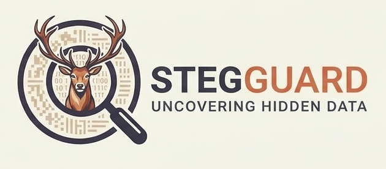
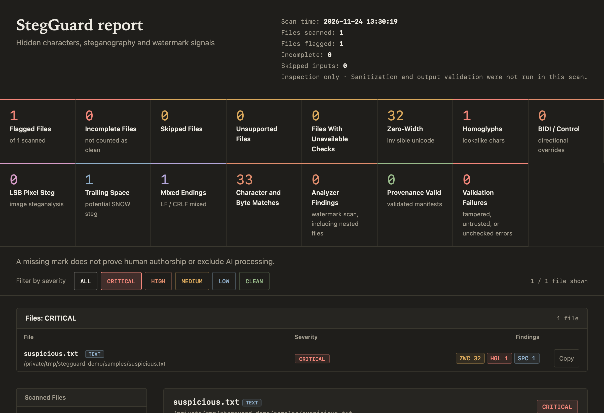

<p align="center">
  
</p>

<h1 align="center">StegGuard</h1>

<p align="center">
  <strong>Find what is hiding in plain sight.</strong><br>
  Local-first CLI and Python library for detecting, decoding, and safely removing hidden payloads, Trojan Source, steganography, and provenance signals.
</p>

<p align="center">
  <a href="https://pypi.org/project/stegguard/"></a>
  <a href="https://www.python.org/"></a>
  <a href="https://github.com/stegguard/stegguard/blob/main/pyproject.toml"></a>
  <a href="https://github.com/stegguard/stegguard/blob/main/LICENSE"></a>
  <a href="https://stegguard.com"></a>
</p>

<p align="center">
  <a href="https://stegguard.com">Website</a> ·
  <a href="https://pypi.org/project/stegguard/">PyPI</a> ·
  <a href="#install">Install</a> ·
  <a href="#see-it-in-action">Demo</a> ·
  <a href="#what-it-detects">What It Detects</a> ·
  <a href="#use-in-ci--github-actions">GitHub Actions</a> ·
  <a href="#python-api">Python API</a>
</p>

---

Hidden content rarely shows up in one neat format. It can be an **invisible zero-width prompt injection** inside a resume or markdown doc, a **Cyrillic homoglyph or bidi override** slipped into a pull request (`pаypal`), trailing whitespace channels, bytes appended after a PNG or JPEG, or a **C2PA Content Credential** that was never cryptographically verified.

Most tools handle one of those cases. StegGuard gives them one offline workflow:

```text
untrusted file -> detect -> inspect -> decode -> sanitize a copy -> verify
```

### Why StegGuard?

- **Zero runtime dependencies** — pure Python standard library (`>=3.12`), offline by default, no telemetry or unsolicited network calls.
- **One tool across text, code, docs, and media** — scans source files, prompts, PDFs, Office archives, PNG/JPEG/WAV, and C2PA manifests.
- **Safe by default** — never modifies originals unless you pass `--in-place --confirm`; emits SHA-256 hashes, unified diffs, and re-scan verdicts.
- **Reports built for humans and pipelines** — versioned JSON (`report-v1.schema.json`), standalone HTML reports, and CI-ready exit codes (`0` clean, `1` findings, `2` error).
- **Fast and bounded** — scans 1 MiB of plain text in ~275 ms ([benchmarks](https://github.com/stegguard/stegguard/blob/main/benchmarks/BASELINE.md)) with configurable memory, nesting, and decompression limits.

---

## Install

Run immediately without installing via [`uv`](https://docs.astral.sh/uv/):

```bash
uvx stegguard detect . -r --no-venv
```

Or install from [PyPI](https://pypi.org/project/stegguard/):

```bash
python3 -m pip install stegguard
```

Optional extras and source install:

```bash
# Wider image-format decoding via the explicitly tested Pillow path
python3 -m pip install "stegguard[images]"

# From source
git clone https://github.com/stegguard/stegguard.git
cd stegguard
python3 -m pip install -e .
```

Requires Python 3.12–3.14. See [docs/platform-support.md](https://github.com/stegguard/stegguard/blob/main/docs/platform-support.md) for platform details.

---

## See it in action

https://github.com/user-attachments/assets/5be03bc5-4263-46e0-88b3-3a4bef847827

Suppose `prompt.txt` looks completely normal in your editor (`Summarize this resume. Visit pаypal.com`), but hides zero-width characters and a Cyrillic `а` (`U+0430`):

```bash
stegguard detect prompt.txt
```

```text
📄 prompt.txt

  ⚠  ZERO-WIDTH CHARACTERS DETECTED — Severity: HIGH
    Line    1  Col   23  Char #22  Byte @0x0000016  U+200B  Zero Width Space
    Line    1  Col   24  Char #23  Byte @0x0000019  U+200C  Zero Width Non-Joiner
    Line    1  Col   25  Char #24  Byte @0x000001C  U+200D  Zero Width Joiner

  ⚠  HOMOGLYPH CHARACTERS DETECTED — Severity: LOW
    Line    1  Col   35  Char #34  Byte @0x000002A  U+0430  Cyrillic а  looks like="а"

  ⚠ 1/1 file(s) flagged   (exit code: 1)
```

Decode any recognized payload without touching the file, then write a verified clean copy:

```bash
stegguard decode prompt.txt
stegguard sanitize prompt.txt
```

`sanitize` writes `prompt.sanitized.txt` (preserving the original) and returns SHA-256 hashes before/after, exact change counts, and a unified diff:

```diff
--- prompt.txt
+++ prompt.sanitized.txt
@@ -1 +1 @@
-Summarize this resume.​‌‍​ Visit pаypal.com
+Summarize this resume. Visit paypal.com
```

### Run the built-in end-to-end demo

Clone the repo and run the deterministic, offline demo (encodes `DEMO` in zero-width characters, detects and decodes it, sanitizes a copy, verifies it, and analyzes a synthetic PNG for watermark/provenance signals):

```bash
python3 demo/run_demo.py
```

Then open `demo-output/reports/detect.html` to inspect the standalone HTML report. See [demo/README.md](https://github.com/stegguard/stegguard/blob/main/demo/README.md) for every generated artifact.

<p align="center">
  
</p>

---

## Quick start

```bash
# Scan a single file
stegguard detect suspicious.py

# Recursively scan a repository and emit JSON + HTML reports
stegguard detect ./repo -r --no-venv --json findings.json --html report.html

# Decode hidden channels (zero-width, whitespace, line endings, metadata, pixel LSB)
stegguard decode suspicious.txt

# Write a sanitized copy with hashes, change counts, and unified diff
stegguard sanitize suspicious.txt

# Analyze watermark, fingerprint, and provenance signals
stegguard watermark image.png --json watermark.json --html watermark.html

# Cryptographically validate C2PA Content Credentials via c2patool
stegguard watermark image.png --c2pa-tool c2patool --html provenance.html
```

### Batch pipeline

Chain `detect` -> `decode` / `sanitize` over an entire codebase:

```bash
stegguard detect . -r --no-venv --json findings.json
stegguard decode --from-findings findings.json --min-sev high
stegguard sanitize --from-findings findings.json --output-dir clean/
```

Each sanitized file reports `clean_after` (the result of re-scanning its output). Files that are missing or fail to scan are reported rather than silently skipped, and the command exits `2`.

### Commands & exit codes

| Command | What it does |
| --- | --- |
| `stegguard detect` | Scans files or directories for hidden-content signals |
| `stegguard decode` | Extracts recognized payloads without modifying the input |
| `stegguard sanitize` | Writes a safer copy and reports every change |
| `stegguard watermark` | Analyzes watermark, fingerprint, and provenance evidence |

Run `stegguard COMMAND --help` for options and examples, or `--help-all` for resource limits (`--max-*`). Set `NO_COLOR=1` to disable ANSI colors.

For `detect`: `0` = clean scan, `1` = findings detected, `2` = invalid input or incomplete scan. Full contract and [supported file types](https://github.com/stegguard/stegguard/blob/main/docs/compatibility.md#supported-file-types) are in [docs/compatibility.md](https://github.com/stegguard/stegguard/blob/main/docs/compatibility.md).

---

## Use in CI / GitHub Actions

Block pull requests that introduce invisible Unicode, bidi overrides (Trojan Source), or homoglyphs:

```yaml
name: StegGuard Scan
on: [pull_request]

jobs:
  stegguard:
    runs-on: ubuntu-latest
    steps:
      - uses: actions/checkout@v4
      - uses: actions/setup-python@v5
        with:
          python-version: "3.12"
      - run: pip install stegguard
      - run: stegguard detect . -r --no-venv --html stegguard-report.html --json findings.json
```

---

## How it compares

| Capability | StegGuard | `exiftool` | `steghide` | `c2patool` | Ad-hoc regex |
| --- | :---: | :---: | :---: | :---: | :---: |
| Zero-width, bidi & homoglyphs | Yes | — | — | — | Partial |
| Whitespace & line-ending channels | Yes | — | — | — | Partial |
| Media LSB, WAV & container structure | Yes | Metadata | Embed/extract | — | — |
| C2PA manifest inspection & validation | Yes* | Partial | — | Yes | — |
| Safe diffed sanitization | Yes | Metadata | — | — | Manual |
| Standalone HTML + schema JSON reports | Yes | JSON | — | JSON | — |
| Zero runtime dependencies | Yes | Perl | C++ libs | Rust bin | Yes |

\*Cryptographic C2PA validation delegates to the official `c2patool` executable when `--c2pa-tool` is provided.

---

## What it detects

### Text & source files
- Zero-width and invisible Unicode characters
- Bidirectional controls (Trojan Source) and suspicious formatting characters
- Cyrillic and Greek homoglyphs
- Trailing-space and tab channels (including SNOW-style patterns)
- Mixed and encoded line-ending patterns
- Repeated punctuation, spacing, and layout intervals

### Images, audio & structured media
- Pixel-level LSB anomalies (reported separately from robust watermarks)
- Transform and block-correlation signals in decodable lossless images
- Phase, echo, spectral, spread-spectrum, and silence-interval statistics in PCM WAV
- PNG metadata, private chunks, and appended trailing data
- JPEG EXIF, XMP, and IPTC indicators
- RIFF trailing data, ISO BMFF private boxes, and PSD structures
- Pluggable analyzers for compressed codecs, keyed schemes, and video

### Documents & containers
- PDF embedded files and active or hidden structures
- DOCX, PPTX, XLSX, ZIP, and compatible archive members
- Nested media and archives with bounded member and decompression limits
- SVG and HTML comments, hidden styles, and external references

### Watermarks & provenance
- Metadata, structural, text-pattern, and layout evidence
- Robust image, audio, and video signal families
- Device, camera, printer, encoder, and codec fingerprints
- Embedded and sidecar C2PA manifests (validated via `c2patool`)
- External manifest references with opt-in, bounded HTTPS retrieval
- Pluggable AI text-watermark verifiers

Detection categories stay strictly separate: an LSB anomaly is never reported as a robust watermark, and the presence of a C2PA manifest is never reported as cryptographic validation.

---

## Safe sanitization

Sanitization rewrites validated plain-text `.txt` and `.log` files (UTF-8 or BOM-marked UTF-16) and leaves originals untouched unless both `--in-place` and `--confirm` are passed.

- **`conservative` profile (default):** Removes hidden characters only where they have no legitimate use — preserves non-Latin scripts (e.g., Russian), emoji ZWJ sequences, Persian/Hindi joiners, and consistent CRLF, while still repairing mixed-script lookalikes (`pаypal` -> `paypal`). Anything preserved is flagged in `warnings`.
- **`destructive` profile:** Strips all target channels even when it may alter legitimate text (`stegguard sanitize suspicious.txt --profile destructive`).
- **Selective channels:** Repeat `--channel` with `zero_width`, `bidi`, `homoglyphs`, `trailing_whitespace`, or `line_endings`.

Every JSON report includes `sanitization_status` (`SANITIZED`, `PARTIAL`, `NOT_SUPPORTED`, `VALIDATION_FAILED`), SHA-256 hashes, unified diff, and before/after provenance impact.

---

## Python API

All core workflows are available as Python functions returning JSON-compatible dictionaries:

```python
from stegguard import analyze_file, decode_file, sanitize_file, scan_file

detection = analyze_file("suspicious.txt")
decoded = decode_file("suspicious.txt")
sanitized = sanitize_file("suspicious.txt")
watermarks = scan_file("image.png")
```

Machine-readable reports carry `schema_version` matching the packaged `stegguard/schemas/report-v1.schema.json` contract.

---

## Trust model & current limitations

StegGuard is **alpha software**. Treat its findings as investigative evidence, not as an infallible verdict.

- **Offline by default:** No unsolicited network requests. Remote C2PA manifests require `--allow-remote-manifests` (HTTPS-only, no redirects, no non-global IPs, strict timeout and size caps).
- **Explicit states:** C2PA provenance is reported as `VALID`, `TAMPERED`, `UNTRUSTED_SIGNER`, `MISSING`, `UNSUPPORTED`, or `NOT_CHECKED`. Missing analysis is never reported as clean.
- **No fabricated verdicts:** Without `c2patool`, embedded C2PA claims stay `NOT_CHECKED`. Keyed/proprietary watermarks, compressed codecs, and video require their configured analyzer. No official Anthropic text-watermark verifier is bundled, and StegGuard does not guess.
- **Authorship disclaimer:** Valid provenance confirms validation under the configured trust store; it does not prove authorship, and a missing mark does not prove human authorship.
- **Resource bounds:** Review [docs/resource-limits.md](https://github.com/stegguard/stegguard/blob/main/docs/resource-limits.md) before scanning untrusted uploads in a service.

---

## Development & contributing

```bash
git clone https://github.com/stegguard/stegguard.git
cd stegguard
uv run pytest
uv run pytest --cov=stegguard --cov-report=term-missing
uv run ruff check stegguard tests demo scripts benchmarks
```

The runtime is intentionally dependency-free. Bug reports, synthetic fixtures, detector improvements, and false-positive reports are welcome at [github.com/stegguard/stegguard](https://github.com/stegguard/stegguard) — please do not commit live suspicious payloads or credentials.

Docs & policies: [contributing](https://github.com/stegguard/stegguard/blob/main/CONTRIBUTING.md), [security](https://github.com/stegguard/stegguard/blob/main/SECURITY.md), [support](https://github.com/stegguard/stegguard/blob/main/SUPPORT.md), [governance](https://github.com/stegguard/stegguard/blob/main/GOVERNANCE.md), [releases](https://github.com/stegguard/stegguard/blob/main/RELEASING.md), [detection quality](https://github.com/stegguard/stegguard/blob/main/docs/detection-quality.md), [benchmarks](https://github.com/stegguard/stegguard/blob/main/benchmarks/BASELINE.md), and [changelog](https://github.com/stegguard/stegguard/blob/main/CHANGELOG.md).

## License

Licensed under the Apache License 2.0. See [LICENSE](https://github.com/stegguard/stegguard/blob/main/LICENSE) and [NOTICE](https://github.com/stegguard/stegguard/blob/main/NOTICE).
